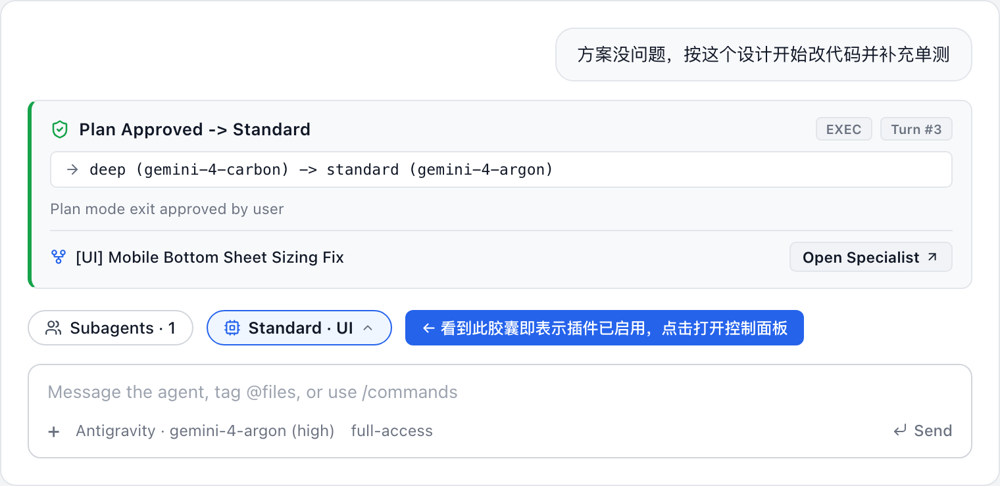
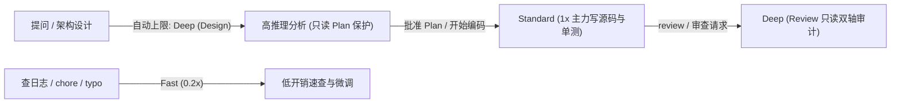
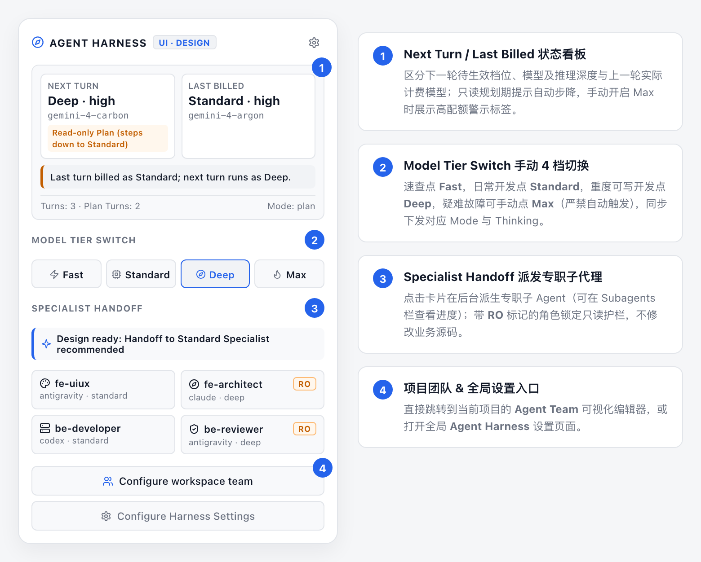
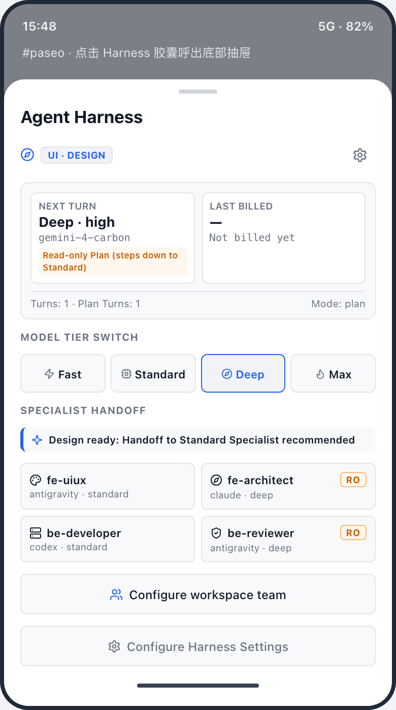
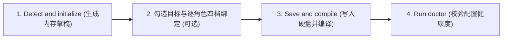
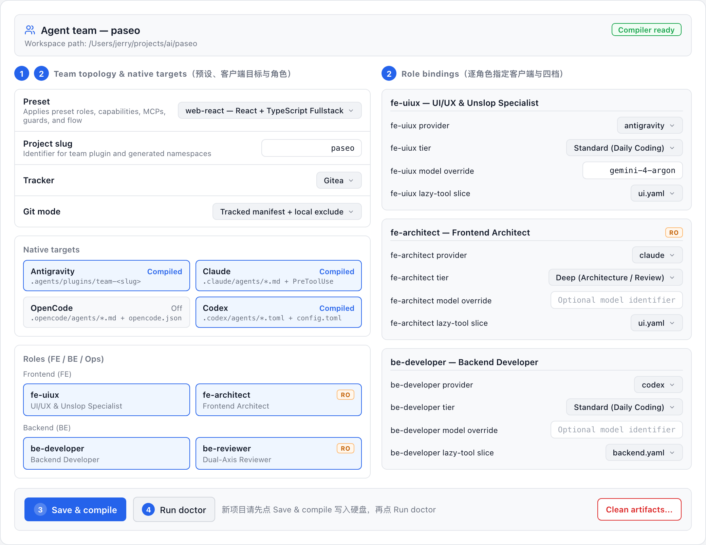
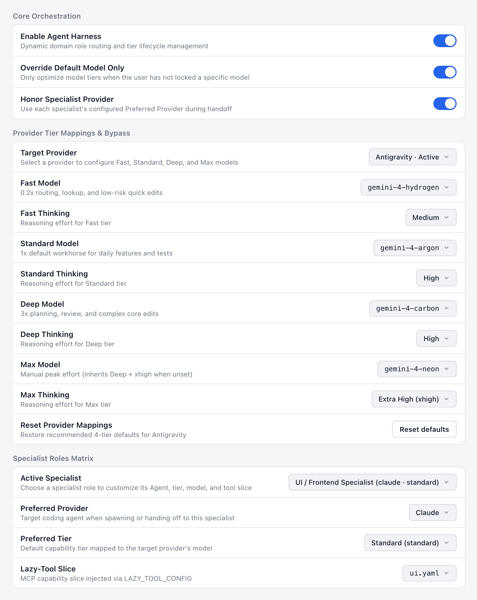

# Agent Harness 使用指南

> 本文面向日常使用 Paseo 的开发者，介绍四档模型自动换挡、控制面板、项目级团队编排与全局设置。架构设计与 RPC/钩子参考见 [README.md](README.md)。

## 一、解决什么问题

在 Paseo 中运行 Coding Agent 时，常见两类痛点：

1. **模型档位与任务复杂度不匹配**：高开销推理模型做简单排查耗时长、额度消耗高；轻量模型做架构分析或代码审查容易遗漏边界。
2. **单会话上下文膨胀**：同一对话内混合需求讨论、前端样式、后端协议与安全审计，工具集合和历史上下文互相干扰。

**Agent Harness 在后台自动承担两项职责**：

- **单维度 4 档复杂度阶梯（`Fast · Standard · Deep · Max`）**：架构设计与代码审查自动升至 **Deep**（3x 上限）；批准方案或进入编码自动步降至主力 **Standard**（1x）；查日志与轻度微调切至 **Fast**（0.2x）；**Max** 为最高推理峰值，严格仅限手动切换，绝不自动触发。
- **按专长派发子代理（Specialist Handoff）**：在当前工作区直接派生专职子 Agent（前端、后端、测试、审查等），各自仅加载对应角色的技能与 MCP 工具切片。

---

## 二、10 秒确认插件已生效

打开任意工作区（Workspace）中的任意对话（Agent），查看底部输入框上方的胶囊栏：

- 看到 **`Harness ^`**（或 **`Standard · UI ^`**、**`Deep · Architect ^`**、**`Next: Deep · Billed: Standard ^`** 等标签），即表示插件已启用并接管当前会话。
- 对话时间线中出现的 **Harness Transition** 卡片（例如 `Plan Approved -> Standard`），记录每次自动换挡与派发子代理的档位、模型及原因。

---

## 三、四档模型阶梯一览（`Fast · Standard · Deep · Max`）

| 档位         | 倍率 | 默认推理深度  | 触发方式            | 适用场景与内置角色归属                                                                                                                                                                                                                     |
| :----------- | :--- | :------------ | :------------------ | :----------------------------------------------------------------------------------------------------------------------------------------------------------------------------------------------------------------------------------------- |
| **Fast**     | 0.2x | low / medium  | 自动路由 + 手动可切 | 查状态/日志、`chore:`/`docs:`/`style:` 微调、薄调度中枢 `orchestrator` 与敏捷探针 `scout`                                                                                                                                                  |
| **Standard** | 1x   | medium / high | 自动主力 + 手动可切 | 日常特性开发、单测与缺陷修复；`ui`、`backend`、`qa`、`general` 默认档                                                                                                                                                                      |
| **Deep**     | 3x   | high          | 自动上限 + 手动可切 | **只读 `design` 阶段**：架构与产品规划（`pm`、`architect`），批准后自动步降至 Standard **只读 `review` 阶段**：代码审计与 `agy + ocr delegate` 门禁（`review`） **手动可写 `exec` 阶段**：面板点选 Deep 写源码时保持可写且不自动降档 |
| **Max**      | 峰值 | xhigh         | **严格仅限手动**    | 复杂并发故障或核心算法推演。**永不自动触发**，在状态看板展示 `Manual Max · High quota usage` 提示，避免意外高配额消耗                                                                                                                      |

---

## 四、三种使用方式（从简单到进阶）

### 方式 1：日常单人对话（全程自动换挡）

直接像平时一样在输入框提问，插件会在 `Fast` / `Standard` / `Deep` 之间按意图自动切换（最高止步于 `Deep`）：

| 输入内容示例                                                 | 自动切换结果                      | 实际行为                                                                                    |
| :----------------------------------------------------------- | :-------------------------------- | :------------------------------------------------------------------------------------------ |
| `查一下最近的日志` 或 `chore: 更新依赖`                      | **Fast**（`exec`）                | 切至低开销模型执行检索、状态查看或文档/格式微调                                             |
| `fix: 修复空指针报错` 或 直接让它编写功能                    | **Standard**（`exec`）            | 使用日常主力编码模型直接修改源码并运行单测                                                  |
| `帮我设计一下权限模块的架构方案`                             | **Deep**（`design` 只读保护）     | 选用高推理模型输出方案；在 Claude / OpenCode 下自动进入只读 Plan 模式，避免确认前改动源码   |
| 审批通过 Plan（`ExitPlanMode`），或回复 `就按这个方案改代码` | 自动步降至 **Standard**（`exec`） | 方案确认后立即从 Deep 步降至 Standard，恢复写入权限开始实现，避免后续简单修改按 3x 持续计费 |
| `review 一下刚才的改动`                                      | **Deep**（`review` 只读门禁）     | 选用 Deep 模型，按代码规范与需求契约执行只读双轴审计与 `ocr delegate` 规则检查              |

---

### 方式 2：通过 `Harness` 胶囊手动换挡与派发专家

点击输入框上方的 **`Harness ^`**（或 **`Standard · UI ^`**）胶囊，打开控制面板：

1. **状态与计费看板（`Next Turn` / `Last Billed`）**
   - **Next Turn**：下一条消息将要使用的档位、推理深度（`Thinking`）与模型；处于只读规划期时显示 `Read-only Plan (steps down to Standard)`，手动启用 `Max` 时显示 `Manual Max · High quota usage`。
   - **Last Billed**：上一轮实际计费使用的档位、推理深度与模型；刚发生自动换挡时底部横幅会明确提示前后差异。
2. **单行手动切换四档（`Fast | Standard | Deep | Max`）**
   - 点击所需档位，下一条消息立即生效，并同步下发该档位对应的 `Mode` 与 `Thinking` 设置。
   - 手动点击 **`Deep`** 或 **`Max`** 时默认解除 `Plan` 只读锁定，进入可写 `exec` 阶段执行重度开发，写入源码时不会自动降档。
3. **派发专家子代理（`Specialist Handoff`）**
   - 方案确定后，点击面板中的专家卡片即可在当前工作区创建后台专职**子 Agent**（默认内置 `UI Specialist`、`Backend Specialist`、`QA Specialist`、`Gate Specialist`；若项目配置了 `.agents/agent-team.json`，则自动切换为项目定制角色，如 `fe-uiux`、`fe-architect`、`be-developer`、`be-reviewer`）。
   - 派发后可随时从输入框旁的 **Subagents** 胶囊进入查看进度与结果。
   - 名称旁标注 **`RO`** 的角色为**只读专家**（如架构师、审查员），受只读护栏保护，不修改业务源码。
4. **底部配置入口**
   - **`Configure workspace team`**：打开当前项目的 Agent Team 可视化编辑器（见方式 3）。
   - **`Configure Harness Settings`**：进入全局模型映射与插件设置页（见第五节）。

> **手机端说明**：在移动端点击 `Harness ^` 胶囊会以底部抽屉形式展开上述全部控制项。

---

### 方式 3：为项目配置专属团队（Agent Team 面板）

如果项目有明确技术栈（如 React 前端、Go 后端），或希望固定分工（例如“前端走 Antigravity Standard、架构走 Claude Deep、后端走 Codex Standard、审查走 Antigravity Deep”），可使用工作区团队编辑器。

#### 打开方式（任选一种）

- 点击输入框上方的 **`Harness ^`** 胶囊，选择底部的 **`Configure workspace team`**；
- 打开 Command Center，搜索并执行 **`Configure workspace agent team`**；
- 在文件树中直接打开项目根目录的 `.agents/agent-team.json`（已初始化项目）。

#### 新项目配置四步骤

1. **第 1 步：生成初始草稿**
   首次在未初始化的仓库中打开面板，会显示 `No agent team manifest found`。
   - 点击 **`Detect & initialize`** 自动探测项目技术栈并推荐预设，或直接点选下方预设卡片（如 `lean-solo`、`web-react`、`go-api`）。
   - _此时配置仅生成为内存草稿，尚未写入磁盘。_
2. **第 2 步：勾选客户端目标、角色与逐角色绑定（可选）**
   - **左侧区域（`Team topology & native targets`）**：设置 `Preset`、`Project slug`、`Tracker`、`Git mode`，勾选原生客户端目标（`Antigravity`、`Claude`、`OpenCode`、`Codex`）、启用角色（按 `FE / BE / Ops` 分组）、能力模块、MCP 数据源与安全守卫（`Safety guards`）。
   - **右侧区域（`Role bindings`）**：逐角色设置 `provider`、`tier`（`Fast` / `Standard` / `Deep` / `Max`）、`model override` 与 `lazy-tool slice`；留空则继承全局默认配置。
3. **第 3 步：点击 `Save & compile` 保存并编译（必做）**
   - 原子写入 `.agents/agent-team.json` 并同步调用编译器生成所选客户端的本地角色定义。
   - 完成后，聊天框 **`Harness ^`** 胶囊内的 `Specialist Handoff` 列表即时刷新为该项目角色。
4. **第 4 步：点击 `Run doctor` 核验配置健康度（可选）**
   - 落盘后 `Run doctor` 即可点击，用于检查清单、编译产物与守卫规则是否完整；如需清理生成产物，点击右下角 **`Clean artifacts...`** 按确认弹窗操作。

---

## 五、何时需要进入全局设置（`Configure Harness Settings`）

日常保持默认即可；需要自定义模型、推理深度或内置专家归属时，从 **Settings → Plugins → Agent Harness**（或胶囊底部 **`Configure Harness Settings`**）进入：

1. **配置各客户端的四档模型与推理深度（`Provider Tier Mappings & Bypass`）**：
   - 先在 **`Target Provider`** 选定客户端（如 `Antigravity`、`Claude`、`Codex`、`OpenCode`、`Pi`），再为 `Fast` / `Standard` / `Deep` / `Max` 分别通过 **`<Tier> Model`** 与 **`<Tier> Thinking`** 下拉选定目录模型与推理深度（`Low` / `Medium` / `High` / `Extra High (xhigh)`）。
   - 仅当选择 **`Custom Model ID...`**（或配置了目录外模型）时才会展开自定义文本输入框；点击 **`Reset Provider Mappings -> Reset defaults`** 可恢复当前客户端的推荐四档配置。
2. **调整内置专家的默认客户端与默认档位（`Specialist Roles Matrix`）**：
   - 先在 **`Active Specialist`** 选定角色，再按需修改 **`Preferred Provider`**、**`Preferred Tier`**、**`Model Override`** 或 **`Lazy-Tool Slice`**，后续派发该专家即生效。

---

## 六、常见问题（FAQ）

1. **为什么自动路由最高只到 `Deep`，从不自动切到 `Max`？**
   - `Max` 对应旗舰高推理档位，配额消耗较高。将其限定为手动触发可避免日常问答或常规开发产生意外高额消耗；遇到复杂疑难问题时，可随时在 `Harness` 控制面板手动点选 `Max`。
2. **某个客户端只有 3 个模型，没有单独的 `Max` 模型怎么办？**
   - 将 **`Max Model`** 保持为 **`Inherit Deep (Fallback)`**（留空）即可。手动切到 `Max` 时，插件会自动复用 `Deep` 档模型并将 `Thinking` 提升至 `xhigh`。
3. **为什么刚点完 `Detect & initialize`，底部按钮仍显示 `Run doctor (save first)`？**
   - `Doctor` 校验的是磁盘上已写入的 `.agents/agent-team.json` 与编译产物，不检查未保存的内存草稿。先点击 **`Save & compile`** 落盘，按钮即可点击。
4. **为什么面板顶部显示 `NATIVE ORCHESTRATOR`，且四个切档按钮灰置不可点？**
   - 当前会话运行的是原生具备调度与换挡能力的编排模型（如匹配 `^gemini-pro-orchestrator` 的模型）。为避免插件策略与原生编排冲突，插件自动豁免并锁定切档；下方的 **Specialist Handoff** 与 **Agent Team** 入口仍可正常使用。
5. **在 Git Worktree 分支工作区中修改团队配置会影响主仓库吗？**
   - 不会。Worktree 默认只继承主仓库配置（页面顶部显示 `Inherited from main project`）；只有点击 **`Materialize & compile in worktree`** 后才会在当前 Worktree 独立写入并编译一份配置，主仓库保持不变。

---

## 七、相关文档与源码索引

- 架构、契约与维护文档：[README.md](README.md)
- 客户端贡献入口：[index.client.tsx](index.client.tsx)
- 服务端生命周期与钩子：[index.server.ts](index.server.ts)
- 胶囊控制面板：[harness-popover.tsx](client/harness-popover.tsx)
- 项目团队可视化编辑器：[team-editor-panel.tsx](client/team-editor-panel.tsx)
- 全局设置页面：[settings-screen.tsx](client/settings-screen.tsx)
- 默认档位与内置专家定义：[presets.ts](shared/presets.ts)
