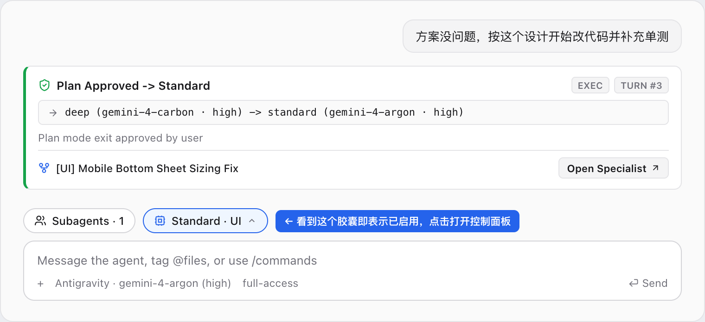
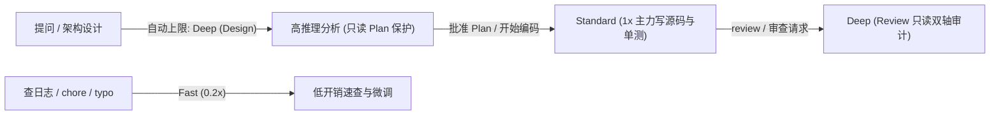
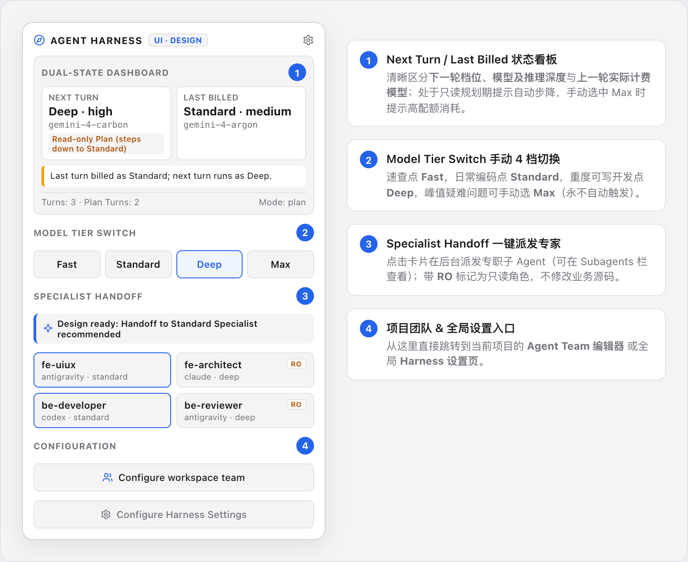
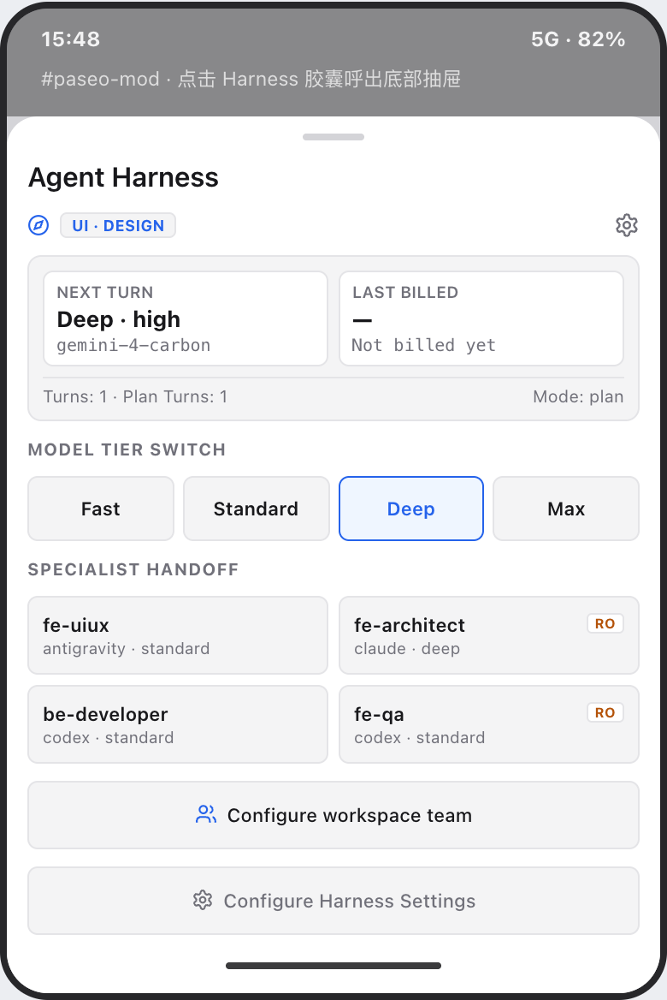
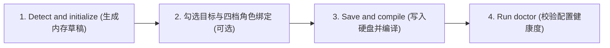
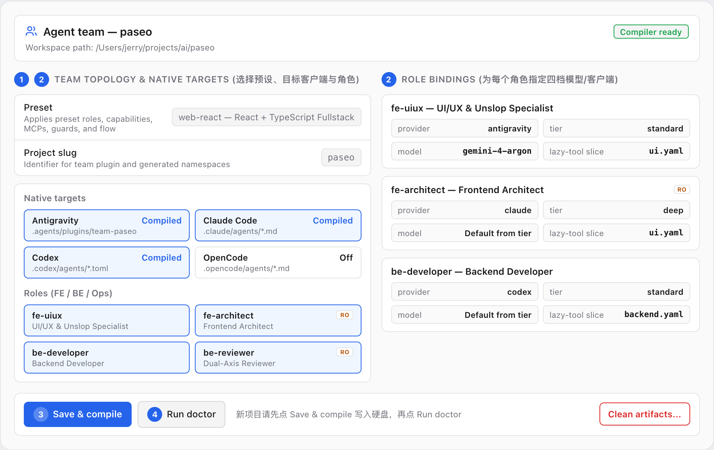
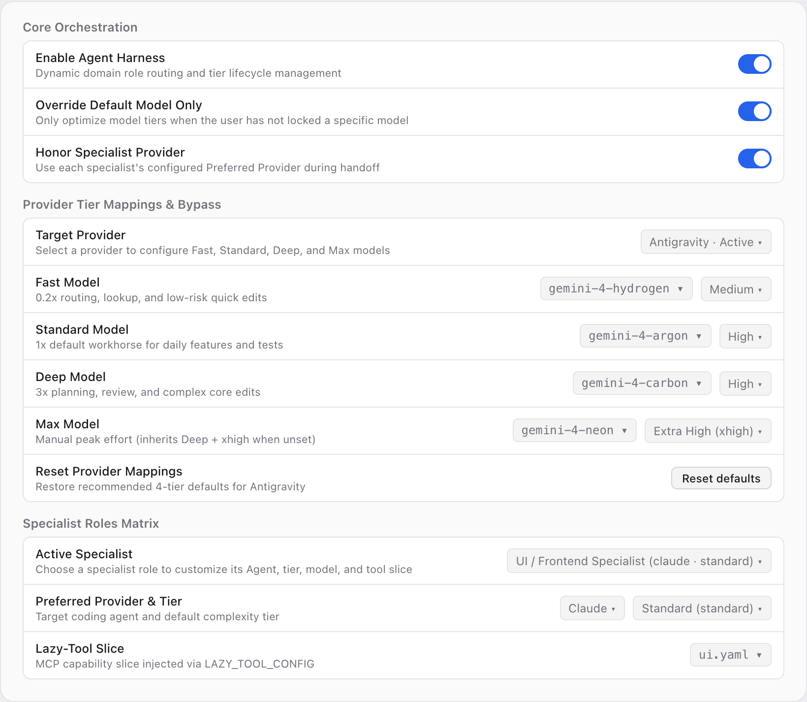

# Agent Harness 新手使用指南

## 一、它是什么？能帮你解决什么问题？

平时在 Paseo 里使用 AI 编写代码时，常会遇到两个问题：

1. **模型不会自动按任务复杂度换挡**：用高开销推理模型去改错别字，速度慢、额度浪费高；用轻量模型做架构分析，又容易考虑不周。
2. **单个对话越来越杂乱**：在同一个长对话里既讨论需求、又写前端界面、又修改后端与数据库，上下文互相干扰，挂载的工具也越来越多。

**Agent Harness 插件在后台自动承担两项职责**：

- **单一维度的 4 档复杂度阶梯（`Fast · Standard · Deep · Max`）**：讨论架构或执行代码审查时自动升至 **Deep**（3x 上限）；确认方案并开始写代码时自动步降至日常主力 **Standard**（1x）；查日志与轻度杂项切至 **Fast**（0.2x）；**Max** 为最高推理峰值，严格仅支持手动开启，绝不自动触发，账单可控。
- **按专长派发子代理（Specialist Handoff）**：需要编写界面、修改后端、补充测试或做代码审查时，从当前会话直接派发专职子 Agent 在后台处理，各自只加载对应角色的技能与 MCP 工具。

---

## 二、10 秒确认插件已生效

打开任意工作区（Workspace）中的任意对话（Agent），查看底部输入框上方的一排胶囊按钮：

- 只要看到 **`Harness ^`**（或显示 `Standard · UI`、`Deep · Architect`、`Next: Standard · Billed: Deep` 等字样），即说明插件已正常启用并接管当前会话。
- 对话时间线中出现的 **Harness Transition** 卡片，则是插件自动换挡与派发子代理时留下的追踪记录。

---

## 三、四档模型阶梯一览（`Fast · Standard · Deep · Max`）

| 档位         | 倍率 | 推理深度      | 自动还是手动            | 适用场景与内置角色归属                                                                                                                                                                                                                        |
| :----------- | :--- | :------------ | :---------------------- | :-------------------------------------------------------------------------------------------------------------------------------------------------------------------------------------------------------------------------------------------- |
| **Fast**     | 0.2x | low / medium  | 自动路由 + 手动可切     | 查状态/日志、`chore:`/`docs:`/`style:` 微调、薄调度中枢 `orchestrator` 与敏捷探针 `scout`                                                                                                                                                     |
| **Standard** | 1x   | medium / high | 自动默认主力 + 手动可切 | 约 80% 的日常特性开发、测试与缺陷修复；`ui`、`backend`、`qa`、`general` 默认档                                                                                                                                                                |
| **Deep**     | 3x   | high          | 自动最高上限 + 手动可切 | **只读 `design` 阶段**：架构探讨与产品规划（`pm`、`architect`），批准后自动步降至 Standard **只读 `review` 阶段**：代码审计与规则门禁（`review`） **手动可写 `exec` 阶段**：面板点选 Deep 写入源码时保持可读可写，不会自动降回 Standard |
| **Max**      | 峰值 | xhigh         | **严格仅限手动**        | 极难并发故障或核心算法推演。**永不自动触发**，在状态看板展示 `Manual Max · High quota usage` 警示，保证额度透明可控                                                                                                                           |

---

## 四、三种使用方式（从简单到进阶）

### 方式 1：日常单人对话（全程自动换挡）

你只需要**像平时一样在输入框提问**，插件会自动根据输入意图在 `Fast` / `Standard` / `Deep` 之间切换（最高止步于 `Deep`）：

| 你输入的内容示例                                                 | 插件自动切换结果                  | 实际行为                                                                                    |
| :--------------------------------------------------------------- | :-------------------------------- | :------------------------------------------------------------------------------------------ |
| `查一下最近的日志` 或 `chore: 更新依赖`                          | **Fast**（`exec`）                | 切换为低成本轻量模型快速检索与微调                                                          |
| `fix: 修复空指针报错` 或 直接让它写新功能                        | **Standard**（`exec`）            | 使用均衡稳定的主力编码模型直接修改源码并执行单测                                            |
| `帮我设计一下权限模块的架构方案`                                 | **Deep**（`design` 只读保护）     | 选用高推理模型输出方案；在 Claude / OpenCode 下自动进入只读 Plan 模式，避免确认前直接改源码 |
| 点击审批通过 Plan（`ExitPlanMode`），或回复 `就按这个方案改代码` | 自动步降至 **Standard**（`exec`） | 方案确认后立刻从 Deep 步降为 Standard，释放写入权限开始实现，避免后续简单修改按 3x 持续计费 |
| `review 一下刚才的改动`                                          | **Deep**（`review` 只读门禁）     | 使用 Deep 模型，按代码规范与需求契约执行只读审计                                            |

---

### 方式 2：通过 `Harness` 胶囊手动换挡与派发帮手

点击输入框上方的 **`Harness ^`** 胶囊，可打开控制面板：

1. **状态与计费看板（`Next Turn` / `Last Billed`）**
   - **Next Turn**：你**下一句话**发出后将要使用的档位、模型及推理深度（`thinkingOptionId`）。
   - **Last Billed**：**上一轮对话**实际计费使用的档位与模型。刚发生自动换挡时两者会分开展示，看板也会给出明确对比说明。
   - 若手动启用了 **`Max`**，状态卡会显示橙色 **`Manual Max · High quota usage`** 徽章。
2. **单行手动切换四档（`Fast | Standard | Deep | Max`）**
   - 直接点击所需档位，下一条消息立即生效：手动点击 **`Deep`** 或 **`Max`** 时会默认解除 `Plan` 只读锁定，直接进入可写 `exec` 阶段执行重度编码，且修改业务源码时不会自动降档。
3. **派发专家子代理（`Specialist Handoff`）**
   - 当主对话已经明确方案、不希望主上下文继续膨胀时，直接点击面板中的专家卡片（默认提供 **`UI Specialist`**、**`Backend Specialist`**、**`QA`**、**`Gate`** 等）：
   - 点击后会在当前工作区创建一个专职**子 Agent** 并在后台运行，可从输入框旁的 **Subagents** 栏随时进入查看进度与结果。
   - 名称旁标注 **`RO`** 的角色属于**只读专家**（如架构师、审查员），只读代码并提出意见，不会修改源码文件。
4. **底部配置入口**
   - **`Configure workspace team`**：配置当前项目专属的 AI 团队（见方式 3）。
   - **`Configure Harness Settings`**：修改全局模型映射与插件开关。

> **手机端说明**：在移动端点击 `Harness ^` 胶囊会以底部抽屉形式展开上述全部控制项。

---

### 方式 3：为项目配置专属团队（Agent Team 面板）

如果你的项目有固定技术栈（如 React 前端、Go 后端），或者希望明确约定**“前端交给 Antigravity、后端交给 Codex、审查交给 Antigravity Gate”**，可以使用项目级团队配置面板。

#### 如何打开面板（任选一种）

- 点击聊天框上方的 **`Harness ^`** 胶囊，选择底部的 **`Configure workspace team`**；
- 按快捷键打开命令面板（Command Center），搜索并执行 **`Configure workspace agent team`**；
- 在文件树中打开项目根目录下的 `.agents/agent-team.json`（已初始化项目）。

#### 新项目配置四步骤（注意保存顺序）

1. **第 1 步：生成初始草稿**
   首次在未初始化的项目中打开面板，会显示 `No agent team manifest found`。
   - 点击 **`Detect & initialize`**（自动检测项目技术栈并推荐预设），或直接点击下方的预设卡片（如精简双人组 `lean-solo`、前端组 `web-react`、后端组 `go-api`）。
   - _此时配置仅生成为页面草稿，尚未写入硬盘。_
2. **第 2 步：勾选角色与指定绑定模型（可选）**
   - **左侧区域**：勾选项目使用的客户端目标（`Native targets`，如 `Antigravity`、`Claude`、`Codex`、`OpenCode`）、启用的角色（`FE / BE / Ops`）、MCP 工具与安全守卫（`Safety guards`）。
   - **右侧区域（`Role bindings`）**：为已选角色单独指定客户端（Provider）、四档中的某一档（`fast` / `standard` / `deep` / `max`）或具体模型名；留空则沿用全局设置。
3. **第 3 步：点击 `Save & compile` 保存并编译（必做）**
   - 点击底部的 **`Save & compile`**，系统会将 `.agents/agent-team.json` 写入项目并编译生成各客户端所需的本地角色配置。
   - 写入完成后，点击聊天框的 **`Harness ^`** 胶囊，`Specialist Handoff` 列表即会刷新为本项目定制的角色列表。
4. **第 4 步：点击 `Run doctor` 核验配置健康度（可选）**
   - 保存并编译落盘后，底部的 **`Run doctor`** 按钮即可点击，用来校验清单文件、生成的角色定义与守卫规则是否完备。
   - 如需清理生成文件，点击右下角 **`Clean artifacts...`** 按提示确认即可。

---

## 五、何时需要进入全局设置（`Configure Harness Settings`）

大多数场景保持默认即可；需要调整模型或角色归属时，从 **Settings → Plugins → Agent Harness**（或胶囊底部 **`Configure Harness Settings`**）进入：

1. **配置各客户端的 `Fast · Standard · Deep · Max` 模型与推理深度**：
   - 在 **`Provider Tier Mappings & Bypass`** 区域先选定客户端（`Target Provider`），为每档分别用 **`<Tier> Model`** 下拉选定目录模型，用 **`<Tier> Thinking`** 下拉选定推理深度（如 `Medium`、`High`、`Extra High (xhigh)`）。
   - 仅当选择 **`Custom Model ID...`** 时才会额外显示自定义文本输入框；点击 **`Reset Provider Mappings -> Reset defaults`** 可随时恢复当前客户端的推荐配置。
2. **调整内置专家的默认客户端与默认档位**：
   - 在 **`Specialist Roles Matrix`** 区域先选定某个角色（`Active Specialist`），修改它的 `Preferred Provider` 或 `Preferred Tier`，后续通过 `Harness` 胶囊派发该角色时即采用新设置。

---

## 六、常见问题（FAQ）

1. **为什么插件会自动限制在 `Deep`，从来不自己切到 `Max`？**
   - `Max` 通常代表最高推理档或旗舰高配额模型。将其设计为“严格仅限手动触发”，是为了避免在常规问答或代码编写中被自动高消费账单；若你遇到复杂问题希望动用最高推理，可在 `Harness` 胶囊或面板下拉手动选择 `Max`。
2. **如果某客户端只有 3 个可用模型，没有单独配第 4 个 `Max` 模型怎么办？**
   - 在 `Max Model` 中保持 **`Inherit Deep (Fallback)`**（留空）即可。手动切换到 `Max` 时，插件会自动复用 `Deep` 档模型并将 `Thinking` 提升到 `xhigh`。
3. **为什么刚在未初始化的项目里点完 `Detect & initialize`，按钮仍显示 `Run doctor (save first)`？**
   - `Doctor` 检查的是硬盘上已经存在的 `.agents/agent-team.json` 与编译产物，而非页面内存草稿。请先点击 **`Save & compile`** 落盘，按钮即会恢复为可点击的 `Run doctor`。
4. **为什么有时 `Harness` 面板顶部显示 `NATIVE ORCHESTRATOR`，且切档按钮为灰色不可点？**
   - 表示当前会话正在运行原生具备调度与推理切换能力的编排模型（如 `gemini-pro-orchestrator`）。为防止插件逻辑与模型原生机制冲突，插件会自动锁定并让出自动换挡控制权；下方的 **Specialist Handoff** 与 **Agent Team** 功能仍可正常使用。
5. **在 Git Worktree 分支工作区中修改团队配置会影响主仓库吗？**
   - 不会。Worktree 默认只继承主仓库配置（页面顶部会提示 `Inherited from main project`）；只有当你点击 **`Materialize & compile in worktree`** 时，才会在当前 Worktree 目录独立写入并编译一份配置，主仓库目录保持不变。

---

## 七、源码与配置索引

- 客户端贡献入口：[index.client.tsx](index.client.tsx)
- 服务端生命周期与钩子：[index.server.ts](index.server.ts)
- 胶囊控制面板：[harness-popover.tsx](client/harness-popover.tsx)
- 项目团队可视化编辑器：[team-editor-panel.tsx](client/team-editor-panel.tsx)
- 全局设置页面：[settings-screen.tsx](client/settings-screen.tsx)
- 默认档位与内置专家定义：[presets.ts](shared/presets.ts)
