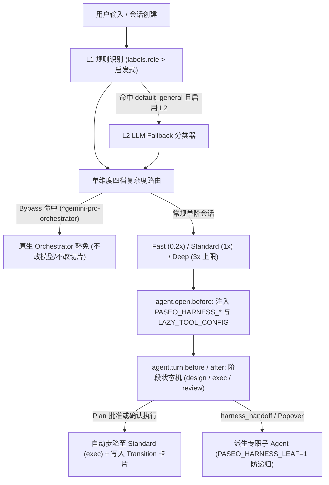

# Agent Harness

`agent-harness` 是 Paseo 的本地能力容器与模型编排插件：在会话创建、打开与跨轮流转阶段，按任务领域识别角色并注入对应 `LAZY_TOOL_CONFIG` 切片与角色提示词，同时以单维度四档复杂度阶梯（`Fast · Standard · Deep · Max`）与配套推理深度（`Thinking`）管理模型路由、阶段护栏与专家子代理交接。

- 日常操作与图解教程见 [GUIDANCE.md](GUIDANCE.md)。
- 规范基线见 [capability-harness/spec.md](../../openspec/specs/agent-harness/capability-harness/spec.md)。

---

## 核心能力与架构



### 1. 四档复杂度阶梯与 `Thinking` 映射

设置版本 `SETTINGS_SCHEMA_VERSION = 8` 将模型路由收敛为单一复杂度/成本维度，并由 `providerThinkingMappings` 为每档独立配置推理深度（`thinkingOptionId`）；当模型路由发生跨档位切换时，`thinkingOptionId` 随目标档位同步更新：

| 档位         | 倍率 | 自动路由 | Antigravity (`Thinking`)       | Claude (`Thinking`) | Codex (`Thinking`) | OpenCode (`Thinking`)     | Pi (`Thinking`)             |
| :----------- | :--- | :------- | :----------------------------- | :------------------ | :----------------- | :------------------------ | :-------------------------- |
| **Fast**     | 0.2x | 允许     | `gemini-4-hydrogen` (`medium`) | `lite` (`low`)      | `lite` (`low`)     | `custom/lite` (`low`)     | `headroom/lite` (`low`)     |
| **Standard** | 1x   | 默认主力 | `gemini-4-argon` (`high`)      | `flash` (`medium`)  | `flash` (`medium`) | `custom/flash` (`medium`) | `headroom/flash` (`medium`) |
| **Deep**     | 3x   | 自动上限 | `gemini-4-carbon` (`high`)     | `pro` (`high`)      | `pro` (`high`)     | `custom/pro` (`high`)     | `headroom/pro` (`high`)     |
| **Max**      | 峰值 | 仅手动   | `gemini-4-neon` (`xhigh`)      | `plan` (`high`)     | `plan` (`xhigh`)   | `custom/plan` (`xhigh`)   | `headroom/plan` (`xhigh`)   |

- **Max 严格手动边界**：L1 规则匹配与 L2 分类器均由 `coerceAutoRoutingTier` 钳位在 `deep`，严禁自动路由到 `max`；手动切入 `max` 后，Popover 状态卡展示 `Manual Max · High quota usage`。若某 Provider 未显式配置 `max` 模型，`resolveTierTarget` 自动回退至 `deep` 模型并将 `thinkingOptionId` 提升为 `xhigh`。
- **模型级旁路豁免**：默认 `bypassModels: ["^gemini-pro-orchestrator"]`。匹配旁路正则的会话（如 Antigravity 原生 Orchestrator）全链路跳过切片注入、MCP 过滤与跨轮降档，Popover 顶部显示 `NATIVE ORCHESTRATOR` 并锁定切档按钮。

### 2. 复杂度档位与执行阶段正交解耦（`MatrixTier` vs `HarnessPhase`）

- 档位（`fast | standard | deep | max`）与阶段（`design | exec | review`）相互独立。
- 原生只读 `plan` 模式仅由 `phase === "design"` 或 `specialist.readonly === true` 决定（针对支持原生 Plan 的 `claude` / `opencode`）。
- 自动设计意图在 `ExitPlanMode` 批准或收到明确执行指令后，自动步降至 `standard`（`phase: "exec"`），恢复写入权限并追加 `harness-transition` 时间线卡片。
- 通过 `HarnessPopover` 手动切换到 `deep` 或 `max` 时默认进入可写 `exec` 阶段（除非角色为 `readonly` 或显式传入 `targetPhase: "design"`），修改业务源码不会触发自动降档。
- 运行时在 `agent.turn.before` / `agent.turn.after` 经 `inferTierFromModel` 与 `reconcileRuntimeHarnessMetadata` 校验活跃模型快照：用户通过 Paseo 原生选择器切换模型或恢复带 v4 遗留档位（`flash`/`plan`/`review`）的会话时，自动同步 `currentTier`、`currentModel`、`currentThinking`、`lastBilled*` 与 `userModelLocked` 状态。

### 3. 内置 9 角色专家矩阵（`BUILTIN_SPECIALISTS`）

未配置工作区 `.agents/agent-team.json` 时启用以下内置专家：

| 角色 ID        | 默认 Provider | 默认档位   | Lazy-Tool 切片   | Popover Handoff | 定位说明                                                         |
| :------------- | :------------ | :--------- | :--------------- | :-------------- | :--------------------------------------------------------------- |
| `orchestrator` | `claude`      | `fast`     | `pm.yaml`        | 否              | 薄调度中枢，负责意图分流与派发专家子代理，不直接编写业务源码     |
| `ui`           | `claude`      | `standard` | `ui.yaml`        | 是（优先级 10） | 前端界面、设计系统与交互实现（`ui-ux-pro-max` / `unslop`）       |
| `backend`      | `codex`       | `standard` | `backend.yaml`   | 是（优先级 20） | 服务端、WebSocket/RPC 协议、存储与并发架构                       |
| `pm`           | `claude`      | `deep`     | `pm.yaml`        | 否              | 痛点挖掘、用户故事与 OpenSpec `proposal.md` 产出                 |
| `architect`    | `claude`      | `deep`     | `architect.yaml` | 否              | 深模块架构设计与领域建模，产出 OpenSpec `design.md`              |
| `qa`           | `codex`       | `standard` | `qa.yaml`        | 是（优先级 50） | 回归测试、边界用例与测试资产体检（`test-gardener`）              |
| `review`       | `antigravity` | `deep`     | `review.yaml`    | 是（优先级 60） | 双轴代码审查（Standards + Spec）与 `agy + ocr delegate` 规则门禁 |
| `scout`        | `pi`          | `fast`     | `scout.yaml`     | 否              | 轻量探针与快速 Spike 原型验证                                    |
| `general`      | 继承调用方    | `standard` | `general.yaml`   | 否              | 通用工程兜底角色（独立磁盘画像 `general.json`）                  |

- **角色独立切片与统一技能根目录**：内置 `LAZY_TOOL_CONFIG` 切片列表已拆分为 8 个角色切片（`general.yaml`、`ui.yaml`、`backend.yaml`、`architect.yaml`、`pm.yaml`、`qa.yaml`、`review.yaml`、`scout.yaml`），彻底移除原共享 `codex.yaml`；内置专家技能根目录统一为 `~/.agents/skills/`。

### 4. 工作区 `agent-team.json` 动态联邦与可视化编辑

- 当工作区 `checkoutRoot`（或 Git Worktree 主仓）存在 `.agents/agent-team.json` 时，动态装载项目定义的 N 个角色及其逐角色 `bindings`（`provider`、`tier`、`model`、`modeId`、`lazyToolSlice`），替换全局内置专家列表。
- 在活跃 `checkoutRoot` 探测到本地多端编译产物（`.agents/plugins/team-*/mcp_config.json`、`.claude/agents/*.md`、`.opencode/agents/*.md`、`.codex/agents/*.toml`）且命中当前会话 `provider` 时，自动启用 Federation Mode：保留本地 MCP 切片并向根会话注入 3 行 `[Agent Harness — Federation Bridge]`。
- Worktree 默认只读继承主仓清单（`inherited_from_main`），仅在用户点击 `Materialize & compile in worktree` 时于当前 Worktree 独立物化编译，不修改主仓。

### 5. Debug Trace 持久化追踪与诊断控制

- **快捷与面板双入口**：`HarnessPopover` 底部提供 `Debug: ON` / `Debug: OFF` 实时开关，设置页提供 `Debug Trace & Diagnostics` 区块（开关切换、日志路径与大小/行数/轮转状态展示、最近追踪条目浏览、`Refresh Logs` 与 `Clear Trace`）。开关切换优先经客户端 `useSettings().save()` 持久化 `debugLogs`，再调用 `agent_harness.debug.toggle.request` 同步服务端运行时并写入 `debug.toggled` 留痕。
- **零 I/O 短路与安全持久化**：开启后将路由、权限拦截、阶段步降与交接事件以 JSONL 写入 `~/.paseo/plugin-data/agent-harness/debug-trace.jsonl`（受 `PASEO_HOME` 环境变量约束）；关闭期间不执行任何磁盘读写。日志目录权限为 `0o700`、文件权限为 `0o600`，单文件达到 `5 MiB` 自动轮转为 `debug-trace.1.jsonl`，并对 Token、Secret、Bearer 与 API Key 字段递归脱敏。

---

## 插件扩展点、钩子与 RPC 契约

### 客户端扩展点（[index.client.tsx](index.client.tsx)）

| 扩展点                 | 注册 ID / 目标                                               | 作用                                                                                         |
| :--------------------- | :----------------------------------------------------------- | :------------------------------------------------------------------------------------------- |
| `addComposerPill`      | `agent-harness`                                              | 输入框上方双态胶囊（`Standard · UI` / `Next: X · Billed: Y`）与控制面板（含 Debug 快捷开关） |
| `addTimelineRenderer`  | `harness-transition` (v1)                                    | 渲染换挡、Plan 批准与子代理交接时间线卡片                                                    |
| `addWorkspacePanel`    | `agent-team-panel`                                           | 工作区 Agent Team 双栏可视化编辑器                                                           |
| `addFilePanel`         | `agent-team-file-panel` (`agent-team.json`)                  | 打开 `.agents/agent-team.json` 时提供表单与原始 JSON 双视图                                  |
| `addSettingsScreen`    | `agent-harness-settings`                                     | 四档 Model + Thinking、旁路规则、专家矩阵、L2 分类器、环境体检与 Debug Trace 诊断页          |
| `addCommandCenterItem` | `Configure Agent Harness` / `Configure workspace agent team` | Command Center 快速入口                                                                      |

### 服务端生命周期钩子与工具（[index.server.ts](index.server.ts)）

- **Hooks**：`workspace.create.before`、`worktree.create.before`、`agent.create.before`、`agent.create.after`、`agent.open.before`、`agent.permission.before`（只读 Shell 白名单自动审批）、`agent.permission.after`（捕获 `ExitPlanMode` 自动步降）、`agent.turn.before`、`agent.turn.after`、`agent.close.after`、`agent.archive.after`。
- **Host Tool & 跨端交接**：`harness_handoff`（支持 `targetRole`、`title`、`specPrompt`、`waitForCompletion`，派生子会话注入 `PASEO_HARNESS_LEAF=1` 阻止递归套娃）；针对 `supportsNativePaseoTools=false` 的 Antigravity 非叶子会话，系统提示词注入基于 `mcp_paseo_create_agent` 派生专家子代理的规范指引。

### RPC 列表（[shared/contracts.ts](shared/contracts.ts)）

- 会话与配置：`agent_harness.tier.switch.request`、`agent_harness.specialist.handoff.request`（父会话 `status === "running"` 时互斥拦截可写专家、放行只读 `review`，并在缺省 `summaryOverride` 时自动注入 `[Parent Session Context]`）、`agent_harness.environment.inspect.request`、`agent_harness.profiles.sync.request`、`agent_harness.config.effective.request`
- 工作区团队编排（按已注册 `workspaceId` 鉴权并按 `checkoutRoot` 互斥串行）：`agent_harness.team.inspect.request`、`agent_harness.team.detect.request`、`agent_harness.team.save.request`、`agent_harness.team.doctor.request`、`agent_harness.team.clean.request`
- 调试追踪与诊断：`agent_harness.debug.status.request`、`agent_harness.debug.toggle.request`、`agent_harness.debug.clear.request`

---

## 配置迁移（v1–v7 -> v8）

`agentHarnessSettings.migrate` 在加载旧版持久化配置时自动执行无损迁移：

1. **v3 -> v4**：内置 `review` 专家默认 Provider 升级为 `antigravity`，技能与门禁切换为 `open-code-review-delegate` 与 `open-code-review-delegate-gate`，同步更新未自定义的 `exec` / `review` 阶段规则。
2. **v4 -> v5**：
   - 未改动的旧 3 档映射自动升级至 4 档默认值并补全 `providerThinkingMappings`；
   - 通过 `normalizeTierAlias`（`lite -> fast`、`flash -> standard`、`plan | review -> deep`）迁移内置与自定义映射；
   - 保留用户自定义模型与自定义档位（如 `ultra`），并清理废弃的 `gemini-3*` 条目。
3. **v5 -> v6**：
   - 升级未自定义的 `ui` 主题/暗黑模式正则与 MCP 列表（移除不存在的 `browser-tools`，对齐 `ui.yaml`）、补全 `general` 的 `sequential-thinking`；
   - 升级未自定义的 `fullstackUiPattern`、`execAction`（覆盖服务启停动作）与 `affirmativeConfirmWords`（补齐 `ok, continue`、`go`），保留用户自定义项。
4. **v6 -> v7 -> v8**：
   - 规范化 `primarySkills`（去除遗留 `superpowers:` / `mattpocock-skills:` 前缀，映射遗留 `pm-*` 技能名）；
   - 将原共享 `codex.yaml` 拆分为 `general.yaml`、`architect.yaml`、`qa.yaml`、`scout.yaml` 角色独立切片；
   - 统一 `ui` 与 `pm` 的 `skillsRoot` 至 `~/.agents/skills`，并扩展 `ui.matchPatterns` 同时保留用户自定义正则与覆盖项。

---

## 目录结构

```text
plugin-custom/agent-harness/
├── paseo-plugin.json          # 插件元信息与 Paseo 最低版本要求
├── package.json               # 包文件清单与开发依赖
├── README.md                  # 架构、契约与开发维护文档（本文件）
├── GUIDANCE.md                # 终端用户图解使用指南
├── screenshots/               # GUIDANCE.md 配套 5 张 UI 示意图
├── index.client.tsx           # 客户端扩展点注册入口
├── index.server.ts            # 服务端生命周期钩子与编排主逻辑
├── client/                    # Popover、Transition 卡片、Settings 与 Team 编辑器 UI
├── server/                    # RPC 处理器、Team 编排服务、Profile 同步与 Handoff 工具
├── shared/                    # 纯跨端类型、Zod 契约、预设、意图检测、状态机与策略
└── tests/                     # 覆盖路由、状态机、迁移、客户端与服务端单测
```

---

## 开发与验证

在仓库根目录执行：

```bash
# 运行 agent-harness 单元测试
npx vitest run plugin-custom/agent-harness/tests/ --bail=1

# 类型检查与代码规范检查
npm run typecheck
npm run lint -- plugin-custom/agent-harness/

# 热重载插件生效（禁止重启 6767 端口主 Daemon）
paseo plugin reload agent-harness
```
